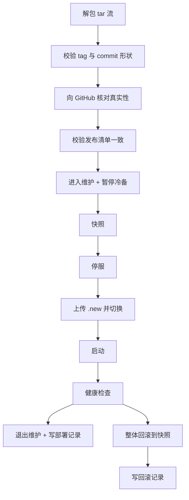

# 部署与运维

Dec Cloud 只有一台服务器。这份文档说明它怎么搭起来、怎么发版、出事怎么回滚。

所有步骤都在服务器上以 root 执行。搞不清楚状态时，先看最后的「排障」一节。

## 唯一部署路径：CI

正式环境只能这样部署：打 `v*` tag 并推送，由 GitHub Actions 构建、发布、部署。

```bash
git tag v2.1.5 && git push origin v2.1.5
```

不要从本地把二进制推到生产。这不是风格偏好，本地部署会绕开三道闸门：tag 与 commit 的真实性核对、发布清单一致性校验、健康检查失败后的自动回滚。绕过去之后，生产上跑的东西与 GitHub 上的 tag 之间就没有可验证的对应关系，出事时无法回答「这是哪个版本、能不能回滚」。

本地构建与本地测试仍然照常使用，它们不碰生产：

```bash
GOWORK=off go build ./... && GOWORK=off go test ./...
./scripts/acceptance.sh          # 本机链路，验证本机代理
```

需要验证「部署这件事本身」时，用隔离实例而不是生产：见下面「测试环境」一节。

## 组成

四个部件，各有边界：

| 部件 | 位置 | 谁写 |
|------|------|------|
| 服务端二进制 | `/opt/dec-cloud/dec-cloud` | 只有部署脚本 |
| 数据目录 | `/var/lib/dec-cloud` | 服务进程 |
| 根密钥 | `/etc/dec-cloud/secret/root.key` | 服务进程，只在初始化时写一次 |
| 部署入口 | `/usr/local/lib/dec-cloud/dec-cloud-deploy.sh` | 只有 root |

根密钥刻意放在数据目录之外：数据目录会被整体快照，`/etc` 不在里面，所以根密钥天然不进快照（需求 16.5、21.5）。部署脚本每次打完快照都会自检一遍，发现快照里有 `root.key` 就删掉并告警。

根密钥单独占一层 `/etc/dec-cloud/secret`，这一层归属服务账号且 700。原因是写密钥用的是「临时文件 + rename」原子写，要求目录本身可写，而 `/etc/dec-cloud` 那层还躺着 `github-token`（`root:root` 0600），不能让服务账号能在那层建文件。两个写权限要求直接冲突，只能分层。

## 测试环境

生产之外另有一套隔离实例，用来跑完整链路验收（登记设备、写 bundle、落地、清理）。
它与生产在同一台机器上，但四条边界都不重叠：

| | 生产 | 测试 |
|---|---|---|
| 数据目录 | `/var/lib/dec-cloud` | `/opt/dec-cloud-test/<slot>/data` |
| 根密钥 | `/etc/dec-cloud/secret/root.key` | `/opt/dec-cloud-test/<slot>/secret/root.key` |
| 端口 | `127.0.0.1:8444`（只回环，公网 443 由 nginx SNI 透传） | `127.0.0.1:18443`（只回环） |
| 单元名 | `dec-cloud` | `dec-cloud-test` / `dec-agent-test` |

```bash
# 在服务器上，准备好两个 Linux 二进制后：
sudo DEC_BW_PASSWORD='<测试账号主密码>' bash deploy/test-e2e.sh --reset
```

测试实例用 `--accept-any` 自签证书，不申请 ACME——它没有域名，也不该占用生产的证书流程。
测试账号是 Bitwarden 的专用账户（2FA 关闭），凭据在 `.secrets/dec/integration/bitwarden.yaml`（gitignored）；
它的根密钥冷备与生产完全独立，两边互不可见。

正式部署**不使用**测试账号：生产初始化需要真实账号的主密码与 2FA，由本人当场输入。

## 三个账号

| 账号 | 用途 | 权限 |
|------|------|------|
| `dec` | 跑服务 | 无 shell、无 sudo |
| `deploy` | CI 部署 | `authorized_keys` 用 `command=` 锁死到部署脚本，拿不到 shell |
| `decops` | 人肉运维 | 唯一有通用 sudo 的普通账号 |

SSH 的登录策略不由本项目的脚本决定。`provision.sh` 默认一行 `sshd` 配置都不写——这台机器不专属 Dec，`AllowUsers` 是白名单语义，写进去就把名单外的账号全锁在外面，包括 root 和其他服务的运维号。只有显式传 `--harden-ssh` 才会写那份 dropin（禁密码、禁转发、限定账号），且只写 `/etc/ssh/sshd_config.d/99-dec-cloud.conf`，删掉该文件再 reload 即可完整回滚。

部署依赖的是 `deploy` 与 `decops` 两个账号各自的 `authorized_keys`，与全局登录策略无关。root 能否登录沿用机器原有配置，长期可用。

## 首次部署

### 1. 准备服务器

一台 Linux（amd64 或 arm64），域名 A 记录指向它。安全组只开 22 和 443。443 由 nginx 持有，dec-cloud 只监听 `127.0.0.1:8444`。

参考配置见 [nginx/stream-sni.conf](nginx/stream-sni.conf)（线上 `/etc/nginx/stream-sni.conf` 的副本，由 nginx.conf 顶层 include）。dec-cloud 的端口改动时，这份配置的 map 要同步。

nginx 必须用 `stream` 模块 + `ssl_preread` 按 SNI 把 `dec.firoyang.com` 的原始 TLS 流透传到 `127.0.0.1:8444`，**不能终止 TLS**：设备身份靠 TLS 客户端证书，ACME 证书也由 dec-cloud 自己用 TLS-ALPN-01 在这条连接上申请续期，nginx 一旦解密，两者都会失效。nginx 自己的其他 HTTPS 站点改为监听回环端口，作为 `ssl_preread` 的 default 后端。

#### 来源 IP 与 PROXY protocol（有顺序要求）

`dec-cloud` 从 v2.1.19 起在 listener 层解析 PROXY protocol（`-proxy-protocol`，默认开启），因此能拿到真实公网来源。这不只是审计取证问题：下载限流按 IP 分桶（每分钟 30 次），在开启之前所有公网请求都呈现为 `127.0.0.1`，共用一个桶，任意爬虫都能把正常用户的额度刷光。

开启需要两步，**顺序不能反**：

1. 先部署带解析的服务端。它对不带 PROXY 头的连接完全兼容，所以在 nginx 还没改之前不会有任何影响。
2. 再把 `/etc/nginx/stream-sni.conf` 里 `127.0.0.1:8445` 那一跳改成**纯字节透传**（配置见仓库内同名文件），`nginx -t && systemctl reload nginx`。

第二步的细节容易写错，这里说清：8445 只需要 `listen 127.0.0.1:8445;` + `proxy_pass 127.0.0.1:8444;`，**既不能写 `listen ... proxy_protocol`，也不能写 `proxy_protocol on`**。

- 写 `listen ... proxy_protocol` 会让 nginx 在这一跳消费掉 443 写好的头，真实来源就此消失；
- 写 `proxy_protocol on` 会让 nginx 向上游重新生成一个头，用的是本机对端地址，真实来源同样消失；
- 两者同时写等于"消费再重新生成"，抓包看到的是 `PROXY TCP4 127.0.0.1 127.0.0.1 <port> 8445`，而不是真实客户端地址。这一点在 2026-10-26 实测确认过，别按直觉改。

反过来做（先改 nginx、后部署服务端）会立刻造成全站不可用：旧服务端不认识这个文本前缀，TLS 握手会直接失败，所有设备同时断连。

`-proxy-protocol` 只允许配合回环监听使用，启动时会校验；监听在 `0.0.0.0` 或公网地址时会拒绝启动。理由是公网直连时客户端可以自报来源 IP，那样限流能被无限绕过、审计里也会出现伪造地址，比"地址不准"更糟。

### 2. 建账号与目录

先把 `provision.sh` 传上去，然后：

```bash
sudo ./provision.sh \
  --domain dec.firoyang.com \
  --deploy-key "ssh-ed25519 AAAA... ci@github" \
  --ops-key    "ssh-ed25519 AAAA... me@laptop"
```

脚本是幂等的，重复跑只是把状态收敛到声明。它会做这些事：建三个账号、建目录与权限、配 fail2ban、开自动安全更新、写 systemd 单元。

它刻意不做三件事：不写 `root.key`（根密钥只能由服务在初始化流程里生成），不申请证书（证书由服务自己取），不改动全局 SSH 登录策略。第三点尤其重要——这台机器可能还跑着别的服务，`AllowUsers` 一写就把名单外的账号全锁死。如果你的机器确实只跑 Dec，可以加 `--harden-ssh` 显式收紧。

### 3. 安装部署入口

`provision.sh` 只在 `authorized_keys` 里引用了入口路径，文件本身要单独放：

```bash
sudo install -m 755 dec-cloud-deploy.sh /usr/local/lib/dec-cloud/dec-cloud-deploy.sh
sudo chown root:root /usr/local/lib/dec-cloud/dec-cloud-deploy.sh
```

放在 `/usr/local/lib` 而不是 `deploy` 账号的家目录：`deploy` 能执行它，但改不了它。

### 4. 填 GitHub 只读 token

部署脚本要向 GitHub 核对「这个 tag 真的存在，而且指向这个 commit」（需求 21.7）。偷到部署私钥的人可以伪造任意部署包，但只要那个 tag 在 GitHub 上不存在，部署就会在改动任何文件之前停下。代码仓库是公开仓库，部署 secret 已放进只允许 `refs/tags/v*` 的 environment；这层 tag 与 commit 的一致性校验是独立的第二道防线，不依赖 environment 规则。

建一个 fine-grained token，只给它 `shichao402/Dec` 的 Contents: Read：

```bash
sudo sh -c 'printf "%s\n" "<token>" > /etc/dec-cloud/github-token'
sudo chmod 600 /etc/dec-cloud/github-token
```

文件权限必须是 0600 且属主 root。`provision.sh` 会建好空占位，这里只填值。

### 5. 配置 GitHub environment 与 secrets

部署凭据不放仓库级 secret，而是放进名为 `production` 的 environment（需求 21.7）。原因是 `DEPLOY_SSH_KEY` 能登录生产机、部署动作会替换服务端二进制，它等价于服务器控制权；仓库级 secret 的含义是「仓库里任何 workflow、任何分支都能引用它」，而 environment 可以限定「只有哪些 ref 能拿到它」。

仓库 → Settings → Environments → New environment，名称填 `production`，然后：

**Deployment branch rules** 选 `Selected branches and tags`，添加一条规则：类型 `tag`，模式 `v*`。这条规则存在 GitHub 设置里，不在仓库文件中，改 workflow 文件绕不过去。公开仓库在免费套餐下可以设置这一项（私有仓库不行，会提示需要升级）。

**Environment secrets** 加四个：

| Secret | 内容 |
|--------|------|
| `DEPLOY_SSH_KEY` | `deploy` 账号对应私钥的全文（含 `BEGIN`/`END` 行） |
| `DEPLOY_KNOWN_HOSTS` | 服务器 host key，见下 |
| `DEPLOY_HOST` | 服务器地址，例如 `dec.firoyang.com` |
| `DEPLOY_USER` | `deploy` |

用命令行等价操作：

```bash
gh secret set DEPLOY_SSH_KEY    --env production < ~/.ssh/dec_cloud_deploy
ssh-keyscan -t ed25519 dec.firoyang.com | gh secret set DEPLOY_KNOWN_HOSTS --env production
printf 'dec.firoyang.com' | gh secret set DEPLOY_HOST --env production
printf 'deploy'           | gh secret set DEPLOY_USER --env production
```

录完 SHALL 删掉同名的仓库级 secret，否则 environment 里的这份形同虚设——job 不挂 environment 时仍能从仓库级取到。检查用 `gh secret list` 与 `gh api repos/{owner}/{repo}/actions/secrets`。

`DEPLOY_KNOWN_HOSTS` 不能靠首次连接自动接受——那等于把中间人攻击的门留着。工作流用 `StrictHostKeyChecking=yes`，host key 对不上直接失败。

**验证迁移是否生效**：`gh api repos/{owner}/{repo}/environments/production/deployment-branch-policies` 应返回 `v*`/`tag`；`gh api repos/{owner}/{repo}/actions/secrets` 不应再出现四个 `DEPLOY_*`。

### 6. 打第一个 tag

```bash
git tag v1.0.0
git push origin v1.0.0
```

工作流会做完整条链路：交叉编译 → 跑测试 → 生成发布清单 → 建 GitHub Release → SSH 部署。任何一步失败都不会碰服务器。

### 7. 初始化（必须本人操作）

部署完成后服务是起来了，但还没初始化。这一步需要 Bitwarden 主密码和 2FA，只能由本人完成——Agent 和 CI 都不该碰。

在本机装代理，然后执行（按提示输入主密码与动态码；主密码不会回显，也不进 shell 历史）：

```
dec-agent configure --url https://dec.firoyang.com
dec-agent initialize --email <你的 Bitwarden 邮箱>
```

根密钥会在服务端生成并落到 `/etc/dec-cloud/secret/root.key`（0600，目录 700 归属服务账号），同时以加密形式写入 Bitwarden 的 `_dec-cloud` 目录作为冷备，写完立刻读回校验。校验不过会回滚本地文件并报错，不会留下「有密钥但没备份」的状态。成功后初始化入口永久关闭，后续设备只能走 `dec-agent enroll`。

## 发版

```bash
git tag v1.2.3
git push origin v1.2.3
```

只有 `v*` tag 会触发发布，且 tag 必须是 `v<主>.<次>.<修>` 三段式，否则构建阶段就退出。

### 要求版本怎么定

发布清单里的 `required_client` 决定「代理低于哪个版本就必须升级」。规则是自动的：

- 如果 `cmd/dec-agent`、`internal/agent`、`internal/proto` 自上一个 tag 以来没改动，沿用上一个要求版本。只修服务端时不该让所有设备去下载一遍。
- 如果改了，要求版本就是本次 tag。
- 如果 `internal/proto/proto.go` 里的协议版本变了、要求版本却没变，构建立刻失败。那种情况等于把不兼容的变更悄悄推给旧代理。

## 部署脚本做了什么

CI 只是把产物打成 tar 推到 stdin，真正干活的是服务器上的入口脚本。顺序固定：



几个刻意的设计：

- 上传时先写 `.new`、全部就位后再逐个 `mv`，把半成品窗口压到最短。
- 停服前就置维护标记，快照失败会把它清掉并原样退出，什么都没动。
- 健康检查比对的是 `server_version`，不是「进程活着」。版本不对说明换上的不是要换的东西。
- 回滚成功后如果旧版本健康，就退出维护。停在维护等于用一次失败部署换来一次无限期停机。回滚后仍不健康则保持维护，等人来。
- 真实性核对放在所有写操作之前。它的作用是：部署私钥一旦泄露，攻击者也只能重放一个 GitHub 上真实存在过的发布，不能推他自己编的版本。

## 部署期文件协作

脚本和服务端是两个进程，中间还夹一次停服，没法靠内存里的状态对话。所以约定用数据目录下 `deploy/` 里三个文件：

| 文件 | 语义 |
|------|------|
| `maintenance` | 存在即为维护状态 |
| `pause-backup` | 存在即暂停冷备推送 |
| `pending.json` | 部署结果，服务端读走记审计后删除 |

服务端每 2 秒看一眼。为什么不用协议方法：部署期间服务本来就是停的，让脚本先连上来置位没有意义；让服务重启后自己看文件最不容易出错——万一脚本置位后崩了，重启仍然看得到维护标记，不会带着半成品对外服务。

这三个文件都不进快照。回滚不该把「正在部署」这个状态一起回滚回去。

## 要求版本怎么下发

部署脚本把 `required_client` 写到 `/var/lib/dec-cloud/required-version`，服务端启动时读它。所以发布即生效，不用另外手动配置。命令行参数 `-required-version` 只在文件不存在时兜底。

## 快照与回滚

每次部署前打一份快照到 `/opt/dec-cloud/snapshots/<UTC时间戳>/`，含二进制、发布清单、`required-version`、`download/` 和整个数据目录。默认只保留最近两份。

手工回滚（部署脚本已经自动做过，这里是兜底）：

```bash
sudo systemctl stop dec-cloud
sudo ls -1dt /opt/dec-cloud/snapshots/* | head -n1   # 挑一份
# 按快照内容覆盖回去，然后
sudo systemctl start dec-cloud
```

注意快照是覆盖式恢复，不会删掉快照里没有的文件。所以 `root.key` 天然不受影响——它不在快照里，也就不会被删。

## 排障

先看部署审计。每次部署都会有一条，包含版本、tag、commit、结果、失败在哪一步：

```bash
sudo grep '"event":"deploy"' /var/lib/dec-cloud/audit/events/*/*.jsonl | tail
```

服务起不来时按顺序查：

```bash
sudo systemctl status dec-cloud
sudo journalctl -u dec-cloud -n 100 --no-pager
sudo ls -la /var/lib/dec-cloud/deploy/    # 维护标记还在就是没退出维护
curl -fsSk https://127.0.0.1/healthz      # 无证书可访问，看一眼真实状态
```

维护标记卡住了（服务其实是好的，但一直显示维护）：确认服务健康后手工删掉标记文件即可，2 秒内生效。

```bash
sudo rm -f /var/lib/dec-cloud/deploy/maintenance
```

`deploy/` 目录的属主必须和服务端进程一致，否则服务端写不了标记，管理面切换维护会静默失败、只剩内存状态。`provision.sh` 建目录时按服务账号 chown，部署脚本每次写文件前也会再 chown 一次。

## 应急命令 dec-emergency

最后手段，只在 Bitwarden 也不可用时用（需求 18.12）。日常吊销设备走管理面，登记新设备走代理的登记流程。

它随部署包一起装到 `/opt/dec-cloud/dec-emergency`，不需要额外安装步骤。

```bash
# 先看清现状：吊销前核对 ID 没抄错，签发前确认 ID 没被占用
sudo -u dec /opt/dec-cloud/dec-emergency devices

# 吊销一台设备（立即生效，不需要它在线配合）
sudo -u dec /opt/dec-cloud/dec-emergency revoke mac-office 设备丢失

# 为一台新机器的公钥直接签发证书
sudo -u dec /opt/dec-cloud/dec-emergency issue-cert spare-laptop ./spare.pub 备用笔记本
```

必须用 `sudo -u dec`，不要用 `sudo`。它以服务账户身份写 SSOT 仓库，用 root 跑虽然会成功，但这次提交写出的对象归 root 所有，之后服务端自己就再也提交不了了。程序会检查这一点并直接拒绝。

签发出来的设备固定是「只接收设备」：能收下发，不能写资产、不能看明文、不能管设备。绕过 Bitwarden 的 2FA 签出的身份不该具备管理能力。需要管理能力时，用这台机器连上之后再走一次正常的 `dec-agent enroll`。

已登记的设备不允许借这条路重签，因为重签会换掉序列号使原证书立即失效，等于在用户不知情时踢掉一台正在用的设备。

它不需要根密钥，因此在服务器处于恢复模式（根密钥丢失）时照常可用，那正是最可能需要它的时候。

## 手工验证

改过部署脚本之后，跑一遍：

```bash
bash deploy/test.sh
```

它用假 `systemctl` 和假 `curl` 把整条链路跑通，覆盖正常部署、健康检查失败回滚、回滚后仍不健康、启动失败、清单不一致、缺文件、非法 tar、非法 tag/commit、快照轮转。不需要服务器，也不会碰真实文件。
