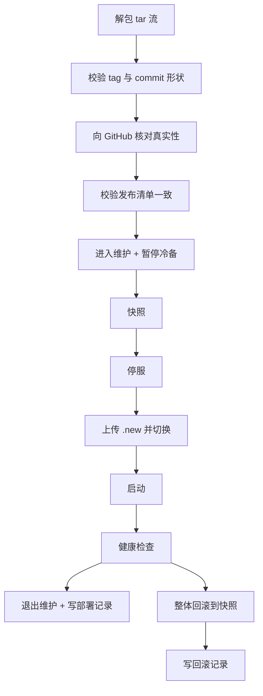

# 部署与运维

Dec Cloud 只有一台服务器。这份文档说明它怎么搭起来、怎么发版、出事怎么回滚。

所有步骤都在服务器上以 root 执行。搞不清楚状态时，先看最后的「排障」一节。

## 组成

四个部件，各有边界：

| 部件 | 位置 | 谁写 |
|------|------|------|
| 服务端二进制 | `/opt/dec-cloud/dec-cloud` | 只有部署脚本 |
| 数据目录 | `/var/lib/dec-cloud` | 服务进程 |
| 根密钥 | `/etc/dec-cloud/secret/root.key` | 服务进程，只在初始化时写一次 |
| 部署入口 | `/usr/local/lib/dec-cloud/dec-cloud-deploy.sh` | 只有 root |

根密钥刻意放在数据目录之外：数据目录会被整体快照，`/etc` 不在里面，所以根密钥天然不进快照（需求 16.5、21.5）。部署脚本每次打完快照都会自检一遍，发现快照里有 `root.key` 就删掉并告警。

根密钥单独占一层 `/etc/dec-cloud/secret`，这一层归属服务账号且 700。原因是写密钥用的是「临时文件 + rename」原子写，要求目录本身可写，而 `/etc/dec-cloud` 那层还躺着 `github-token`（`root:root` 0600），不能让服务账号能在那层建文件。两个写权限要求直接冲突，只能分层。

## 三个账号

| 账号 | 用途 | 权限 |
|------|------|------|
| `dec` | 跑服务 | 无 shell、无 sudo |
| `deploy` | CI 部署 | `authorized_keys` 用 `command=` 锁死到部署脚本，拿不到 shell |
| `decops` | 人肉运维 | 唯一有通用 sudo 的普通账号 |

SSH 只允许公钥登录，禁止密码、禁止 root 直接登录，只允许 `deploy` 和 `decops` 两个账号（`AllowUsers`）。

## 首次部署

### 1. 准备服务器

一台 Linux（amd64 或 arm64），域名 A 记录指向它。安全组只开 22 和 443——服务端需要 443 做 ACME TLS-ALPN-01 证书申请，别的一切都走这一个端口。

### 2. 建账号与目录

先把 `provision.sh` 传上去，然后：

```bash
sudo ./provision.sh \
  --domain dec.firoyang.com \
  --deploy-key "ssh-ed25519 AAAA... ci@github" \
  --ops-key    "ssh-ed25519 AAAA... me@laptop"
```

脚本是幂等的，重复跑只是把状态收敛到声明。它会做这些事：建三个账号、建目录与权限、写 SSH 加固 dropin（写坏会自己回滚并退出）、配 fail2ban、开自动安全更新、写 systemd 单元。

它刻意不做两件事：不写 `root.key`（根密钥只能由服务在初始化流程里生成），不申请证书（证书由服务自己取）。

### 3. 安装部署入口

`provision.sh` 只在 `authorized_keys` 里引用了入口路径，文件本身要单独放：

```bash
sudo install -m 755 dec-cloud-deploy.sh /usr/local/lib/dec-cloud/dec-cloud-deploy.sh
sudo chown root:root /usr/local/lib/dec-cloud/dec-cloud-deploy.sh
```

放在 `/usr/local/lib` 而不是 `deploy` 账号的家目录：`deploy` 能执行它，但改不了它。

### 4. 填 GitHub 只读 token

部署脚本要向 GitHub 核对「这个 tag 真的存在，而且指向这个 commit」（需求 21.7）。偷到部署私钥的人可以伪造任意部署包，但只要那个 tag 在 GitHub 上不存在，部署就会在改动任何文件之前停下。这是私有仓库用不了 environment 保护规则时的等效措施。

建一个 fine-grained token，只给它 `shichao402/Dec` 的 Contents: Read：

```bash
sudo sh -c 'printf "%s\n" "<token>" > /etc/dec-cloud/github-token'
sudo chmod 600 /etc/dec-cloud/github-token
```

文件权限必须是 0600 且属主 root。`provision.sh` 会建好空占位，这里只填值。

### 5. 配置 GitHub secrets

仓库 → Settings → Secrets and variables → Actions，加四个 secret：

| Secret | 内容 |
|--------|------|
| `DEPLOY_SSH_KEY` | `deploy` 账号对应私钥的全文（含 `BEGIN`/`END` 行） |
| `DEPLOY_KNOWN_HOSTS` | 服务器 host key，见下 |
| `DEPLOY_HOST` | 服务器地址，例如 `dec.firoyang.com` |
| `DEPLOY_USER` | `deploy` |

`DEPLOY_KNOWN_HOSTS` 不能靠首次连接自动接受——那等于把中间人攻击的门留着。在自己的机器上取：

```bash
ssh-keyscan -t ed25519 dec.firoyang.com
```

把输出原样贴进 secret。工作流用 `StrictHostKeyChecking=yes`，host key 对不上直接失败。

### 6. 打第一个 tag

```bash
git tag v1.0.0
git push origin v1.0.0
```

工作流会做完整条链路：交叉编译 → 跑测试 → 生成发布清单 → 建 GitHub Release → SSH 部署。任何一步失败都不会碰服务器。

### 7. 初始化（必须本人操作）

部署完成后服务是起来了，但还没初始化。这一步需要 Bitwarden 主密码和 2FA，只能由本人完成——Agent 和 CI 都不该碰。

在本机装代理，然后执行（按提示输入主密码与动态码；主密码不会回显，也不进 shell 历史）：

```
dec-agent configure --url https://dec.firoyang.com
dec-agent initialize --email <你的 Bitwarden 邮箱>
```

根密钥会在服务端生成并落到 `/etc/dec-cloud/secret/root.key`（0600，目录 700 归属服务账号），同时以加密形式写入 Bitwarden 的 `_dec-cloud` 目录作为冷备，写完立刻读回校验。校验不过会回滚本地文件并报错，不会留下「有密钥但没备份」的状态。成功后初始化入口永久关闭，后续设备只能走 `dec-agent enroll`。

## 发版

```bash
git tag v1.2.3
git push origin v1.2.3
```

只有 `v*` tag 会触发发布，且 tag 必须是 `v<主>.<次>.<修>` 三段式，否则构建阶段就退出。

### 要求版本怎么定

发布清单里的 `required_client` 决定「代理低于哪个版本就必须升级」。规则是自动的：

- 如果 `cmd/dec-agent`、`internal/agent`、`internal/proto` 自上一个 tag 以来没改动，沿用上一个要求版本。只修服务端时不该让所有设备去下载一遍。
- 如果改了，要求版本就是本次 tag。
- 如果 `internal/proto/proto.go` 里的协议版本变了、要求版本却没变，构建立刻失败。那种情况等于把不兼容的变更悄悄推给旧代理。

## 部署脚本做了什么

CI 只是把产物打成 tar 推到 stdin，真正干活的是服务器上的入口脚本。顺序固定：



几个刻意的设计：

- 上传时先写 `.new`、全部就位后再逐个 `mv`，把半成品窗口压到最短。
- 停服前就置维护标记，快照失败会把它清掉并原样退出，什么都没动。
- 健康检查比对的是 `server_version`，不是「进程活着」。版本不对说明换上的不是要换的东西。
- 回滚成功后如果旧版本健康，就退出维护。停在维护等于用一次失败部署换来一次无限期停机。回滚后仍不健康则保持维护，等人来。
- 真实性核对放在所有写操作之前。它的作用是：部署私钥一旦泄露，攻击者也只能重放一个 GitHub 上真实存在过的发布，不能推他自己编的版本。

## 部署期文件协作

脚本和服务端是两个进程，中间还夹一次停服，没法靠内存里的状态对话。所以约定用数据目录下 `deploy/` 里三个文件：

| 文件 | 语义 |
|------|------|
| `maintenance` | 存在即为维护状态 |
| `pause-backup` | 存在即暂停冷备推送 |
| `pending.json` | 部署结果，服务端读走记审计后删除 |

服务端每 2 秒看一眼。为什么不用协议方法：部署期间服务本来就是停的，让脚本先连上来置位没有意义；让服务重启后自己看文件最不容易出错——万一脚本置位后崩了，重启仍然看得到维护标记，不会带着半成品对外服务。

这三个文件都不进快照。回滚不该把「正在部署」这个状态一起回滚回去。

## 要求版本怎么下发

部署脚本把 `required_client` 写到 `/var/lib/dec-cloud/required-version`，服务端启动时读它。所以发布即生效，不用另外手动配置。命令行参数 `-required-version` 只在文件不存在时兜底。

## 快照与回滚

每次部署前打一份快照到 `/opt/dec-cloud/snapshots/<UTC时间戳>/`，含二进制、发布清单、`required-version`、`download/` 和整个数据目录。默认只保留最近两份。

手工回滚（部署脚本已经自动做过，这里是兜底）：

```bash
sudo systemctl stop dec-cloud
sudo ls -1dt /opt/dec-cloud/snapshots/* | head -n1   # 挑一份
# 按快照内容覆盖回去，然后
sudo systemctl start dec-cloud
```

注意快照是覆盖式恢复，不会删掉快照里没有的文件。所以 `root.key` 天然不受影响——它不在快照里，也就不会被删。

## 排障

先看部署审计。每次部署都会有一条，包含版本、tag、commit、结果、失败在哪一步：

```bash
sudo grep '"event":"deploy"' /var/lib/dec-cloud/audit/events/*/*.jsonl | tail
```

服务起不来时按顺序查：

```bash
sudo systemctl status dec-cloud
sudo journalctl -u dec-cloud -n 100 --no-pager
sudo ls -la /var/lib/dec-cloud/deploy/    # 维护标记还在就是没退出维护
curl -fsSk https://127.0.0.1/healthz      # 无证书可访问，看一眼真实状态
```

维护标记卡住了（服务其实是好的，但一直显示维护）：确认服务健康后手工删掉标记文件即可，2 秒内生效。

```bash
sudo rm -f /var/lib/dec-cloud/deploy/maintenance
```

`deploy/` 目录的属主必须和服务端进程一致，否则服务端写不了标记，管理面切换维护会静默失败、只剩内存状态。`provision.sh` 建目录时按服务账号 chown，部署脚本每次写文件前也会再 chown 一次。

## 手工验证

改过部署脚本之后，跑一遍：

```bash
bash deploy/test.sh
```

它用假 `systemctl` 和假 `curl` 把整条链路跑通，覆盖正常部署、健康检查失败回滚、回滚后仍不健康、启动失败、清单不一致、缺文件、非法 tar、非法 tag/commit、快照轮转。不需要服务器，也不会碰真实文件。
